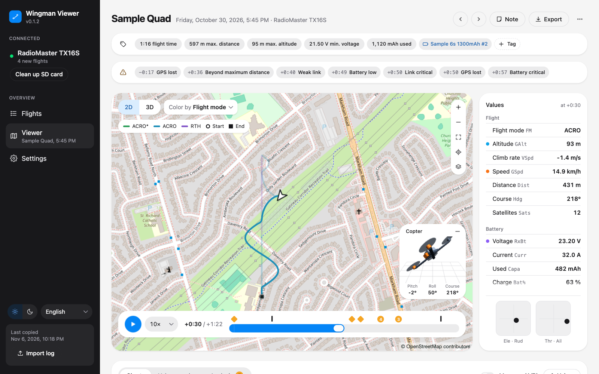
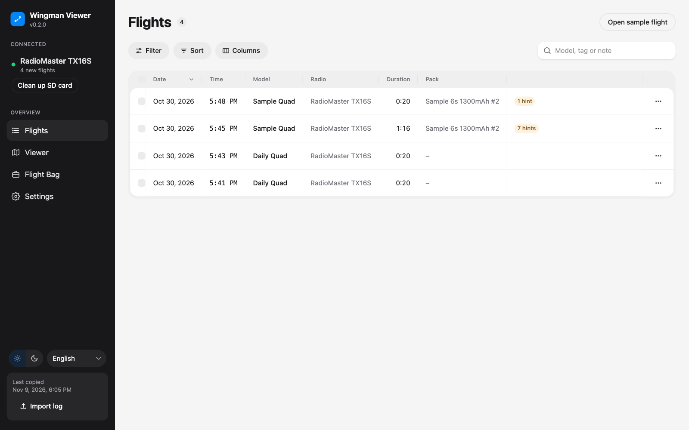
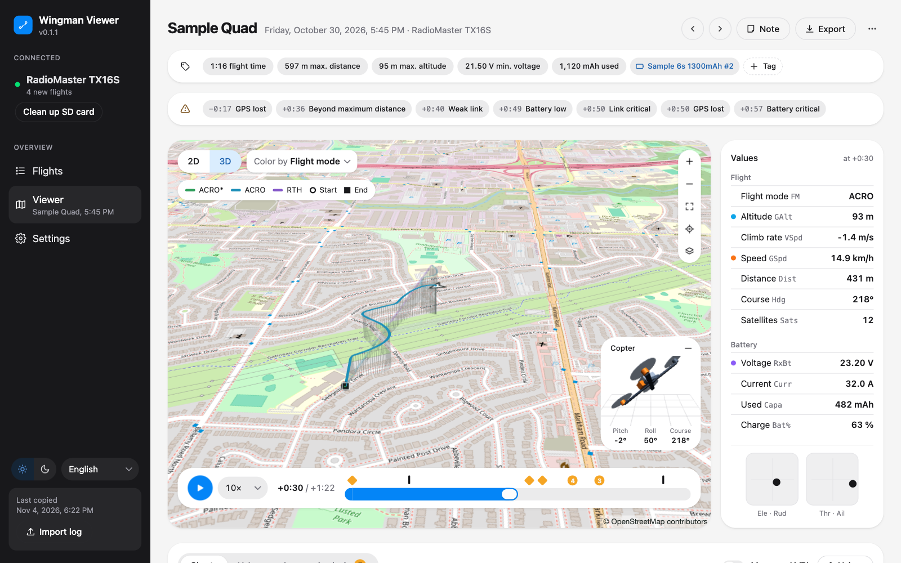
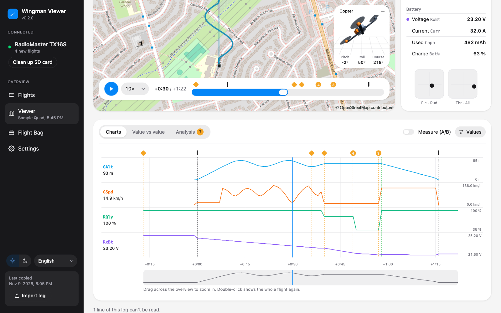
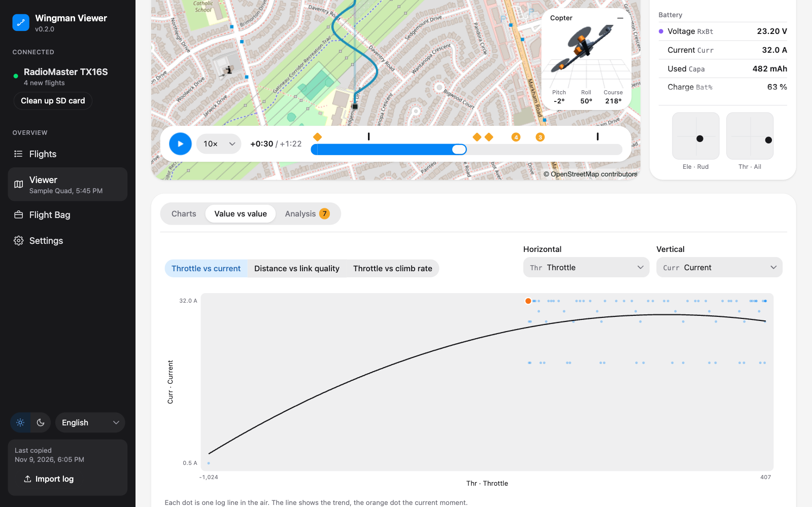
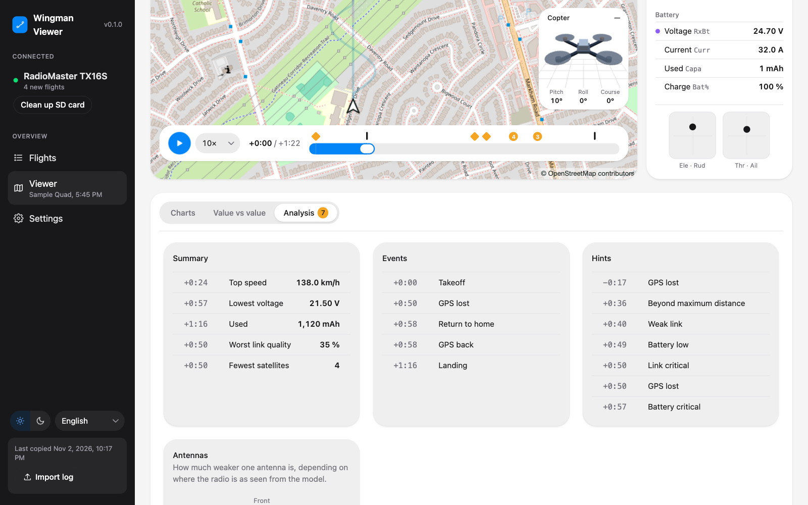

# EdgeTX Wingman Viewer

See every flight from your EdgeTX radio on a map, in 2D and 3D, and play it back with the telemetry values, sticks and charts. Plug in the radio, and the app copies the new logs from its SD card and lists each flight on its own, from arming to disarming.

Desktop app for macOS, Windows and Linux, in English and German (English by default, German in a menu at the bottom of the sidebar). For advanced use, a [browser interface](docs/browser-interface.md) and a [command line tool](docs/command-line.md) are available when running from source.

**Early version:** copying logs, the list of flights, the map with playback, values, charts and export all work. It has been tested with logs from the EdgeTX simulator; the check on a real radio is still to come.

## What it does

- **Copies your logs** as soon as the radio is connected, and keeps them on the computer. Flights stay in the app after you delete the logs on the SD card, and you can look at them without the radio.
- **Lists every flight** in one table with date, time, model, radio, duration and the battery pack. A log with several flights (for example one log per day) shows each flight on its own.
- **Shows the flight path on a map**, in 2D or in 3D at its altitude, colored by flight mode, altitude, speed, link quality, battery or the warning levels of your Lua projects on the radio.
- **Plays the flight back** with a model symbol on the map, the values of every sensor in the log and both sticks at that moment, and a small 3D model of a copter, airplane or flying wing that pitches, rolls and turns as logged.
- **Draws charts** of any values along the flight, with zoom and two cursors to measure the change between two moments, and plots two values against each other (for example throttle against current).
- **Marks events and hints**: takeoff, landing, link lost, failsafe, return to home and GPS lost, and hints such as a weak link or a low battery.
- **Compares both antennas** of a receiver with two antennas by direction, and says where one of them is weaker.
- **Exports flights** as GPX or KML (with a time track for map programs) or as CSV with only the lines of that flight.

It is careful with your data:

- The app only reads the SD card, with two exceptions: "Clean up SD card", which deletes only logs the app already keeps an identical copy of, and saving in Flight Bag, which writes only the settings files of your Lua apps.
- Deleted flights stay under "Recently deleted" for 30 days and can be restored until then.
- Logs are read as EdgeTX writes them; lines the app can't read are skipped and counted, never guessed.

## What the radio needs

EdgeTX writes logs only with the special function "SD Logs" on the model. [Flight Bag](https://github.com/Mariator-pro/edgetx-flight-bag) sets it up for you; you can also add it by hand under the model's special functions.

The map needs a GPS sensor in the telemetry. Without one, the app still shows the flight with its timeline, values and charts.

Where you use [Lipo Nanny](https://github.com/Mariator-pro/edgetx-lipo-nanny), [Link Sentinel](https://github.com/Mariator-pro/elrs-link-sentinel) or [GPS Homer](https://github.com/Mariator-pro/edgetx-gps-homer), their warnings are logged as sensors (`LNst`, `LNpk`, `LSst`, `GHst`), and the app shows the same hints as the radio, colors the path by their warning levels and shows the pack of each flight with its details from Lipo Nanny's settings. EdgeTX adds these sensors only while "Discover new sensors" runs in the model's telemetry; Flight Bag tells you when one is missing. Logs without them get hints for a weak link and a low battery with the same limits as Link Sentinel and Lipo Nanny, and their settings from the SD card where you use them.

## Install

Download the app from the [Releases](https://github.com/Mariator-pro/edgetx-wingman-viewer/releases) page:

- **macOS**: `edgetx-wingman-viewer-macos-arm64-v<version>.zip` for Apple Silicon (M1 and newer) or `edgetx-wingman-viewer-macos-x64-v<version>.zip` for Intel Macs. Unzip it, open the `.dmg` inside and drag the app into Applications.
- **Windows**: `edgetx-wingman-viewer-win64-v<version>.zip`. Unzip it and run the installer inside.
- **Windows, portable**: `edgetx-wingman-viewer-win64-portable-v<version>.zip`, no installation. Unzip it into a folder of its own (the files are at the top of the zip) and start `EdgeTX Wingman Viewer.exe`. Logs, notes and settings go to the same folder as with the installed app.
- **Linux** (x64): `edgetx-wingman-viewer-linux-v<version>.zip`. Unzip it and start the `.AppImage` inside, for example with a double click or `./edgetx-wingman-viewer-linux-v<version>.AppImage`. If it does not start, the system may lack FUSE 2: on Ubuntu 24.04 and newer install it with `sudo apt install libfuse2t64`, on older Ubuntu and Debian with `sudo apt install libfuse2`.

The app is not signed with an Apple or Microsoft certificate, so the system warns on first start:

- **macOS**: the first start shows "Apple could not verify ... is free of malware". Click "Done" (not "Move to Trash"), open System Settings, Privacy & Security, scroll down and click "Open Anyway" next to the blocked app, confirm with your password or Touch ID, then start the app again and choose "Open". Later starts need nothing.
- **Windows**: if a SmartScreen window appears, click "More info" and then "Run anyway".
- **Linux**: no warning. If the file manager does not start the AppImage, mark it as executable (`chmod +x`).

The map loads its tiles from the internet. Without a connection, everything else works, only the map stays empty.

### Updating the app

On start the app looks for a newer release and shows it at the top left:

- **Windows (installed) and Linux**: "Update" downloads the new version, installs it in place and starts it again. Your flights and settings stay.
- **Windows (portable)**: "Download" opens the release page; unzip the new version and delete the old folder.
- **macOS**: "Download" opens the release page. Install the new version like the first one; the app replaces the old one in Applications. macOS accepts an in-place update only for apps signed with an Apple certificate, which this one is not.

## Using it

To look around before your first flight, click "Open sample flight" on the Flights page: a made-up flight that shows what the app can do. It isn't added to your list.

### 1. Connect the radio

Switch the radio on, plug in the USB cable and choose "USB Storage" on the radio, or put its SD card into a card reader. The radio shows up under "Radio" in the sidebar, and the app copies new logs and logs that have grown since the last time (for example a log per day with a new flight), together with the model files and the settings of your Lua projects. When it is done, the sidebar shows how many new flights it found.

Logs from other sources (a backup, a friend's radio) can be added with "Import log" at the bottom of the sidebar. They are listed as "Imported" instead of a radio.

### 2. Flights

The Flights page lists every flight in one table, newest first; click a column header to sort by it, click again to turn the order around. Search for a model, tag, note or battery on the right; "Filter" narrows the list by model, radio, pack and tag or shows recently deleted flights, "Sort" chooses the order and "Columns" hides columns you don't need. The app keeps these choices for the next start; "Reset filters" brings back the full list. Click a flight to open it in the Viewer.

- **Delete**: the menu at the end of a row deletes one flight. Select several with the checkboxes (the one in the header selects all) to delete them together. Only that flight goes, other flights from the same log stay.
- **Recently deleted**: the entry under "Filter" shows deleted flights. "Restore" brings one back; "Delete now" removes it right away instead of after 30 days.
- **Clean up SD card**: the button under the connected radio deletes logs from the SD card that the app keeps an identical copy of, after asking. Logs that changed since the last copy stay on the card.

### 3. Viewer

The Viewer shows the chosen flight. At the top are the model, date and radio, the flight time, maximum distance and altitude, lowest voltage and mAh used, and the pack (click it for its cycles, wear and last use as Lipo Nanny keeps them now), with buttons for the previous and next flight. Add tags with "+ Tag" and a note with "Note"; both show up in the list and work with its search and filter. Above the map, a bar lists the hints of the flight with their time; click one to jump there.

**Map**: "2D" and "3D" switch the view; in 3D the path hangs at its altitude above the start point, with lines down to the ground. "Color by" colors the path by flight mode, altitude, speed, link quality or battery, or green, yellow and red like on the radio by the warning level of Lipo Nanny, Link Sentinel or the worst of all ("All warnings"), with the legend below. The start is marked with a ring, the end with a square. Point at the path to see the time and value there (the values and charts follow), click it to jump there. Zoom, "Show whole flight", "Follow the model" (keeps the model in the middle while playing; moving the map by hand turns it off) and the map type (street map or satellite) are at the top right.

**Timeline**: at the bottom of the map. A flight opens at arming, so Play starts the flight right away (from the moment shown, at 1× to 30× speed). All times in the Viewer count from arming ("+2:25"), the time before it with a minus ("−0:40"). The marks for takeoff and landing show where the flight is. Marks above the slider show events (red for link lost and failsafe), orange diamonds show hints; marks too close together show as one with a count. Click one to jump there.

**Keys**: space plays and pauses, ← and → step 1 s (with Shift 10 s), Home and End go to the start and end of the log (on a Mac fn ← and fn →), N and P go to the next or previous event or hint. Hover over Play to see the list.

**Attitude**: at the bottom right of the map, when the log has pitch and roll (`Ptch`, `Roll`). A small 3D model shows the attitude at the moment shown, seen from the south, so it turns like the arrow on the map. Choose "Copter", "Airplane" or "Flying wing" in its menu; the app keeps the choice for that model on that radio. Until then it shows an arrow.

**Values**: next to the map, every sensor in the log at the moment shown, in plain words with the name EdgeTX uses beside it. The values come in three groups (Flight, Battery, Link); sensors the app doesn't know are folded under "More from the log". Click a value to add it to the charts or take it out; a colored dot marks those shown. Pitch, roll and yaw show in the attitude view, and every value of the log can be shown in the charts. Angles the log has in radians (pitch, roll, yaw) show in degrees, yaw from 0 to 360° like the course. Below are both sticks, arranged by the stick mode set on your radio.

**Charts**: below the map. "Values" chooses which values to show; each gets its own strip with its own scale. Moving the mouse over the charts moves the map, the values and the sticks along. Click to jump to that moment. The time axis has marks counted from arming, and dashed lines show where events and hints are. To zoom, drag across the overview at the bottom; a double click shows the whole flight again. With "Measure (A/B)" on, click twice to set A and B and see the time between them and how much each value changed.

**Value vs value**: one value against another, one dot per log line in the air, with a trend line. Three pairs are ready to pick (throttle vs current, distance vs link quality, throttle vs climb rate), or choose any two values.

**Analysis**: a summary (top speed, lowest voltage, mAh used, worst link quality, fewest satellites, each with its time), then the events and hints of the flight as lists; click one to jump there (a hint also zooms the charts to 30 s before and after it). For a receiver with two antennas (`1RSS` and `2RSS` in the log), "Antennas" shows how much weaker one antenna is depending on where the radio is as seen from the model (front, right, back, left, from the heading in the log), and says what to check. Logs without a heading use the direction from the start instead.

### 4. Export

"Export" in the Viewer saves the flight:

- **GPX**: for maps and most apps.
- **KML**: plays back in map programs with a time slider.
- **CSV**: only the lines of this flight, as EdgeTX writes them, for example to share one flight out of a log per day.

To export many flights at once, use the [command line](docs/command-line.md).

### 5. Flight Bag

With the radio connected, "Flight Bag" in the sidebar sets your Lua apps (Lipo Nanny, Link Sentinel, GPS Homer and Wingman) the way Flight Bag does on the radio: the same fields and rules, read from the apps on the SD card.

- **Warnings, Alerts, Display**: thresholds, sounds (play them on the computer), vibration and what Wingman shows. Settings shared by the apps sit on top under "All apps".
- **Batteries**: Lipo Nanny's batteries with their packs and statistics. Add or edit a battery, add or retire packs.
- **Models**: per model the cells, parallel packs, which batteries it flies with, the telemetry sensors Lipo Nanny reads (chosen from the sensors in the model's file, for any model, not only the selected one) and what Wingman shows for it. "Add model" sets up another model from the SD card. The "SD Logs" setting stays on the radio for now.
- **Last flights**: the last positions GPS Homer stored when the telemetry ended, with "Open map", "Copy position" and, when the app has the flight, "Open flight".
- **Save** writes the settings to the SD card, and writes nothing while a value breaks one of the apps' rules. Each file is written next to the old one first and then replaces it, so unplugging the radio while saving never leaves half a file.

This part is new and not yet checked on a radio.

### 6. Settings

- **Map**: the street map comes from OpenStreetMap. Change the tile address only if you use another tile server with the same layout. Satellite imagery comes from Esri and needs your own ArcGIS key (a free account on ArcGIS Location Platform with basemap access); the app has no key of its own. See [Satellite map](docs/satellite-map.md) for how to create one.
- **Stick mode for imported logs**: logs copied from a radio use the stick mode set on it. For imported logs the app doesn't know it, so choose it here (mode 2 by default).
- **Data folder**: "Open folder" shows where the app keeps your logs (see below).
- **About**: the version, a link to the app's MIT license and its source code, and "Show licenses" with the licenses of all open source packages inside the app.

Appearance (light or dark) and language are chosen at the bottom of the sidebar.

## Your data on the computer

The copied logs, model files and settings of your Lua projects, notes, tags and the app's settings are kept in:

- macOS: `~/Library/Application Support/EdgeTX Wingman Viewer/`
- Windows: `%LOCALAPPDATA%\EdgeTX Wingman Viewer\`
- Linux: `~/.local/share/edgetx-wingman-viewer/` (or `$XDG_DATA_HOME`)

Logs are kept per radio type under `Logs/`, imported ones under `Logs/imported/`. A log whose flights are all deleted waits in `Trash/` for 30 days. The app sends nothing anywhere: no usage data, no error reports. It only goes online for map tiles and to look for a new version of itself.

## More documentation

You do not need any of this to use the app. It is for those who want to go further:

- [Browser interface](docs/browser-interface.md): the same pages as the desktop app, in your web browser
- [Command line](docs/command-line.md): listing flights and exporting many at once from the terminal
- [Satellite map](docs/satellite-map.md): creating your own ArcGIS key for satellite imagery
- [Development](docs/development.md): running from source, building the app and making a release

## License

Released under the [MIT License](LICENSE). The app bundles open source packages under their own licenses, listed under Settings, About, "Show licenses" and in `THIRD_PARTY_LICENSES.txt` in the app's resources folder. Electron's own license files (`LICENSE.electron.txt`, `LICENSES.chromium.html`) are in the same folder on macOS and in the app folder on Windows and Linux. Map data © OpenStreetMap contributors; the attribution of the map in use is always shown on the map.
